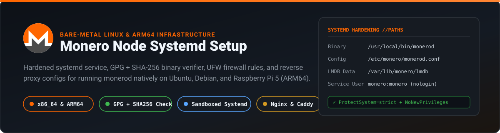
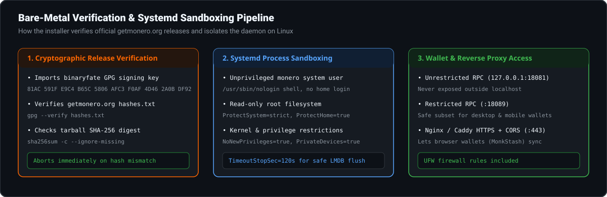

<p align="center">
  
</p>

# Monero Node Systemd Setup (Bare-Metal Linux & ARM64)

Production configurations and verification scripts for running a self-hosted Monero daemon (`monerod`) natively under **`systemd`** on Ubuntu, Debian, Fedora, Arch, or ARM64 single-board computers (such as a Raspberry Pi 5 with an NVMe HAT).

---

## Verification & Sandboxing Architecture

<p align="center">
  
</p>

For a plain-language guide to what a Monero node does and whether you should run a pruned or full database:
- [How to Run a Monero Node](https://monkstash.com/run-a-monero-node)
- [Monero Pruned Node Explained](https://monkstash.com/monero-pruned-node)
- [What Is a Monero Node?](https://monkstash.com/monero-node)

---

## What Is Included

| File | Purpose |
| :--- | :--- |
| [`scripts/install-or-update.sh`](scripts/install-or-update.sh) | Detects `x86_64` or `aarch64` (`arm64`), imports `binaryfate`'s GPG key, verifies `getmonero.org/downloads/hashes.txt`, checks the SHA-256 digest of the official archive, installs `/usr/local/bin/monerod`, and creates the `monero` system user. |
| [`systemd/monerod.service`](systemd/monerod.service) | Hardened `systemd` unit with `ProtectSystem=strict`, `ProtectHome=true`, `NoNewPrivileges=true`, `PrivateDevices=true`, and a 120-second `TimeoutStopSec` for clean LMDB flushes. |
| [`config/monerod-pruned.conf`](config/monerod-pruned.conf) | Pruned Mainnet configuration (~95 GB SSD) with `rpc-bind-ip=127.0.0.1` (unrestricted RPC kept local), `rpc-restricted-bind-port=18089`, DNS blocklist enabled, and UPnP disabled. |
| [`config/nginx-monerod.conf`](config/nginx-monerod.conf) | Nginx TLS reverse proxy config that exposes port `18089` over `https://` (`:443`) with CORS headers (`Access-Control-Allow-Origin: *`) for browser wallets like [MonkStash](https://monkstash.com). |

---

## Step-by-Step Setup on Ubuntu / Debian

### 1. Run the GPG-verified installer

```bash
sudo bash scripts/install-or-update.sh
```

### 2. Install the daemon config and systemd unit

```bash
sudo cp config/monerod-pruned.conf /etc/monero/monerod.conf
sudo cp systemd/monerod.service /etc/systemd/system/monerod.service
sudo systemctl daemon-reload
sudo systemctl enable --now monerod
```

### 3. Monitor synchronization progress

```bash
# Follow systemd journal logs
sudo journalctl -u monerod -f

# Query sync status via local unrestricted RPC
/usr/local/bin/monerod --rpc-bind-port 18081 status
```

---

## UFW Firewall Rules

Allow SSH (`22`), Monero P2P (`18080`), and HTTPS (`443`) if using Nginx/Caddy for remote wallet access:

```bash
sudo ufw allow 22/tcp
sudo ufw allow 18080/tcp comment "Monero P2P"
sudo ufw allow 443/tcp comment "Monero HTTPS Restricted RPC"
sudo ufw enable
```

If you connect directly on port `18089` without a reverse proxy (for desktop or mobile wallets like Feather or Cake Wallet), also allow `18089/tcp`:

```bash
sudo ufw allow 18089/tcp comment "Monero Restricted Wallet RPC"
```

> **Never open port `18081` in your firewall.** Port `18081` is the unrestricted administrative port and is bound strictly to `127.0.0.1` in `config/monerod-pruned.conf`.

---

## Connecting Your Wallet

- **Browser Wallet ([MonkStash](https://monkstash.com)):** Enable [`config/nginx-monerod.conf`](config/nginx-monerod.conf) with a Let's Encrypt certificate and enter `https://node.example.com` in Wallet Settings -> Node. (If running on the same desktop Linux machine as your browser, you can connect directly to `http://127.0.0.1:18089` without Nginx.)
- **Desktop & Mobile Wallets (Feather, Cake Wallet, Monero GUI):** Connect to `node.example.com:443` (SSL) or `<server-ip>:18089`.
- Troubleshooting connection errors: see [Monero Wallet Not Connecting](https://monkstash.com/monero-wallet-not-connecting).

---

## License

Released under the [MIT License](LICENSE).
